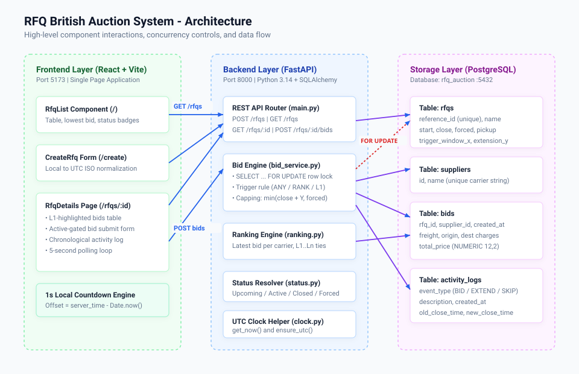
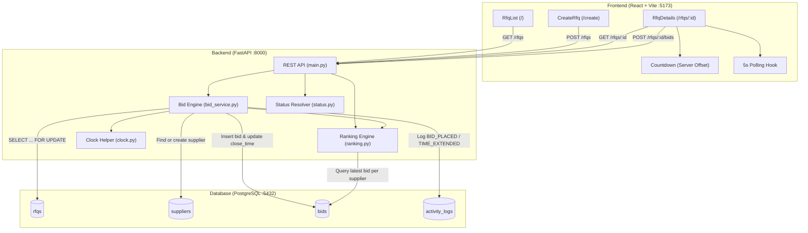

# High Level Design

## Overview

A reverse auction / RFQ system for freight. Buyers create an RFQ with a deadline, suppliers submit competing quotes, and bids placed near the end extend the deadline automatically by Y minutes (British auction rule). An absolute forced close time caps the auction so it can't extend indefinitely.

---

## Architecture Diagram



### Component Diagram (Mermaid)



### Text / ASCII View

```
+-------------------------------------------------------------+
|                     REACT FRONTEND (Vite)                   |
|  - RfqList (/)           - CreateRfq (/create)              |
|  - RfqDetails (/rfqs/:id) with 1s countdown & 5s poller     |
+------------------------------+------------------------------+
                               |  HTTP (JSON)
                               v
+-------------------------------------------------------------+
|                     FASTAPI BACKEND                         |
|  main.py (Routes)                                           |
|    |--> bid_service.py  (Row lock, trigger checks, extend)  |
|    |--> ranking.py      (Latest bid per supplier, L1..Ln)   |
|    |--> status.py       (Upcoming, Active, Closed, Forced)  |
|    +--> clock.py        (Server UTC time)                   |
+------------------------------+------------------------------+
                               |  SQLAlchemy / psycopg2
                               v
+-------------------------------------------------------------+
|                     POSTGRESQL (rfq_auction)                |
|  - rfqs           - suppliers                               |
|  - bids           - activity_logs                           |
+-------------------------------------------------------------+
```

---

## How it works

### 1. Frontend
- Built with React (Vite) and plain CSS. No heavy component libraries.
- Three main screens:
  - **List (`/`)**: shows all RFQs, current lowest price (L1), closing times, and status badge.
  - **Create (`/create`)**: form to set up an RFQ with start time, close time, forced close time, and the extension configuration (X minutes window, Y minutes extension, trigger rule).
  - **Details (`/rfqs/:id`)**:
    - Live countdown: takes server UTC time from the API response, calculates the difference against local browser time, and counts down against that offset.
    - Supplier ranking table (L1, L2, etc.) sorted by total price with the lowest bidder highlighted.
    - Bid submission form: only enabled when status is Active.
    - Activity log: shows bid submissions and time extensions with previous and new close times.
    - Polls `GET /rfqs/:id` every 5 seconds to pick up new bids or extensions made by others.

### 2. Backend
- Built with FastAPI, SQLAlchemy, and psycopg2.
- Status (`Upcoming`, `Active`, `Closed`, `Force Closed`) is calculated on the fly by comparing the current UTC timestamp against `bid_start_time`, `bid_close_time`, and `forced_bid_close_time`.
- Endpoints:
  - `POST /rfqs` - create auction
  - `GET /rfqs` - list auctions (newest first)
  - `GET /rfqs/{id}` - auction details, current ranking, activity log, and server timestamp
  - `POST /rfqs/{id}/bids` - submit a bid and run the extension logic

### 3. Bid Placement & Extension Logic
Everything happens in one atomic database transaction inside `place_bid`:
1. `SELECT ... FOR UPDATE` locks the RFQ row immediately so concurrent bids cannot step on each other or race to calculate the new close time.
2. Checks that the auction is currently Active (start <= now < close).
3. If this carrier already bid on this RFQ before, their new total price (`freight + origin + destination`) must be strictly lower than their own previous total.
4. Takes a snapshot of the supplier rankings right before inserting the bid.
5. Inserts the new bid and writes a `BID_PLACED` entry into `activity_logs`.
6. Calculates the new ranking.
7. If current time is within the trigger window (`close_time - X minutes <= now < close_time`), checks the trigger condition:
   - **ANY_BID**: any valid bid extends.
   - **ANY_RANK_CHANGE**: extends if the ordered list of supplier IDs changed.
   - **L1_CHANGE**: extends only if the cheapest supplier changed.
8. If the trigger fires:
   - New close time is calculated: `min(current_close + Y minutes, forced_close_time)`.
   - If `new_close > current_close`, updates `rfq.bid_close_time` and writes a `TIME_EXTENDED` log.
   - If already at `forced_close_time`, close time doesn't change and an `EXTENSION_SKIPPED` log is written instead.
9. Transaction commits and returns the new bid, updated ranking, and whether an extension happened.
